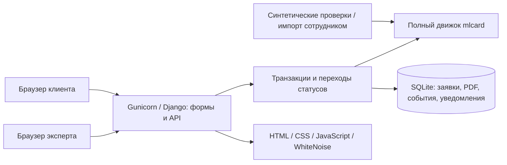

# Alpha — умный кредитный кабинет предпринимателя

Прототип для Альфа-Хакатона: представитель малого бизнеса выбирает финансирование, отправляет заявку с PDF и получает решение в кабинете. Банк видит спорные заявки, исходные данные, причины решения и историю всех рассмотрений. Цель — сократить повторный ввод данных и сделать следующий шаг понятным обеим сторонам.

Проект рассчитан на действующего клиента с предсозданной учётной записью. В MVP входят подбор продукта, калькулятор, анкета, документы, проверка данных, скоринг, уточнения, принятие предложения и моделируемая выдача. Регистрация бизнеса, реальные переводы и юридически значимая подпись за пределами MVP. [Потребности пользователей и продуктовые гипотезы](docs/product.md) основаны на разборе кейса; интервью и измеренные бизнес-эффекты не заявляются.

## Запуск через Docker

Нужны Git и Docker Engine / Docker Desktop с Compose v2. При первой сборке нужен интернет для образа и пакетов. После сборки основной сценарий работает без внешних API, банковских систем, платных подписок и облачных моделей. Python и Node.js на компьютере для запуска сайта не нужны.

Для новой копии:

```sh
git clone https://github.com/falvah/alphahakaton.git
cd alphahakaton
docker compose up --build -d
```

Для существующего проекта на этом компьютере:

```sh
cd /home/xal/alphahakaton
docker compose up --build -d
```

Откройте **http://127.0.0.1:8000**. Контейнер применяет миграции, собирает статику и при `SANDBOX_MODE=true` создаёт синтетические компании, документы, проверочные данные и заявки. Проверка готовности и получение паролей:

```sh
docker compose ps
docker compose logs --tail=100 cabinet
docker compose exec cabinet cat /app/.data/access.txt
```

Дождитесь `healthy`; в `PORTS` должно быть `127.0.0.1:8000->8000/tcp`. **http://127.0.0.1:8000/health/** возвращает `{"status":"ok"}` при доступной базе.

| Логин | Назначение |
|---|---|
| `entrepreneur` | Основной клиент: обычная заявка, черновик и контрольные результаты |
| `expert` | Эксперт: очередь рассмотрения, все решения и журнал |
| `client_growth` | Сценарий спорного решения |
| `client_young` | Молодой бизнес: поручительство или залог |
| `client_risk` | Отрицательные факторы кредитной истории |

Пароли случайные, создаются при первом запуске и сохраняются в `/app/.data/access.txt`. Не публикуйте этот файл. Docker volume `cabinet_data` хранит базу, секрет и доступы; повторный запуск не сбрасывает решения.

```sh
# Остановка с сохранением базы
docker compose down
# Повторный запуск
docker compose up -d
# Обновление после изменения исходников
docker compose up --build -d
```

`docker compose down -v` удаляет базу: для обычной остановки флаг `-v` не нужен.

## Сценарий проверки для жюри

Проверять удобнее на свежем volume отдельного Compose-проекта. Если нужна новая демонстрационная база без удаления текущей, сначала остановите текущий контейнер командой `docker compose down`, затем запускайте `docker compose -p alpha-review up --build -d`. Во всех дальнейших Docker-командах используйте тот же `-p alpha-review`. Две копии одновременно не могут занимать порт 8000.

1. Войдите как `entrepreneur`. На главной посмотрите заявки и персональные материалы. Откройте продукты, выберите оборотное финансирование, укажите **1 500 000 ₽ / 24 месяца**. Шаг изменения суммы — 1 000 ₽; калькулятор показывает предварительный платёж.
2. Создайте заявку с целью «Закупка товаров». На шаге компании оставьте начальные данные: они связаны с подготовленными синтетическими проверками. На шаге документов выберите `fixtures/income-statement.pdf`, подтвердите согласие и нажмите «Оформить». Файл сохраняется при отправке, отдельная предварительная загрузка не обязательна.
3. Ожидаемый результат для этого профиля — автоматическое одобрение. В карточке доступны решение, итоговые условия и история. Примите предложение с подтверждением: статус станет «Средства выданы», появится график платежей. Это имитация выдачи, реального перевода нет.
4. Проверьте альтернативы в «Моих заявках»: исходные контрольные сценарии перечислены ниже. Встречное предложение требует согласия клиента; отказ не допускает принятия.
5. Выйдите и войдите как `expert`. Очередь `/bank/` показывает спорные случаи; на свежей базе используйте заявку `client_growth`. Откройте причины и факторы, примите решение в пределах рассчитанных условий либо запросите уточнения с комментарием. Если заявка не назначена, сначала возьмите её в работу.
6. Войдите соответствующим клиентом: результат или запрос уточнений виден в той же заявке и уведомлениях. После изменения профиля прежние проверочные данные могут стать неактуальными: такая заявка требует нового расчёта экспертом. Для его JSON сумма, срок, ИНН и ОГРН должны совпадать со снимком заявки, дата оценки должна быть актуальной. Формат — [docs/reference/input-format.md](docs/reference/input-format.md), примеры — `fixtures/scorecard/`.
7. У эксперта откройте «Вся история заявок» (`/bank/?view=history`) и журнал (`/bank/audit/`): там видны автоматические и ручные решения, а не только очередь.
8. Покажите персональную ленту, упомянутую на стр. 7 кейса: сравните главные страницы `entrepreneur` и `client_young`. Для зрелого бизнеса предлагается выписка за 12 месяцев, для молодого — поручительство/залог. После запроса уточнений появляется «Банк ждёт уточнений»; ещё один материал учитывает последний выбранный продукт. Это локальные справочные материалы, не внешние банковские новости.
9. Перезапустите контейнер через `docker compose restart cabinet` и убедитесь, что заявка и история сохранились.

| Контрольные данные | Результат расчёта |
|---|---|
| `fixtures/scorecard/good_mature.json` | Одобрение 1 500 000 ₽ на 24 месяца |
| `fixtures/scorecard/reduced_amount.json` | Запрос 10 000 000 ₽ → предложение 8 310 000 ₽ |
| `fixtures/scorecard/mass_address.json` | Отказ по стоп-фактору массового адреса |

Контрольные JSON содержат фиксированную дату оценки. Их можно использовать для сверки модели; для нового рассмотрения/принятия действует проверка свежести — 30 дней. При старой демонстрационной базе не ожидайте автоматического обновления источников: начальное заполнение сохраняет пользовательские изменения. На новом volume обычные профили получают источники с текущей датой. Подробнее: [автоматические решения](docs/automatic-decisions.md).

## Архитектура и компоненты



| Компонент | Назначение и причина выбора |
|---|---|
| Python 3.14.8, Django 5.2.18 | Модульный монолит: формы, сессии, CSRF, ORM и серверные шаблоны в одном приложении |
| Gunicorn, WhiteNoise | HTTP-приложение и локальная статика без CDN; один контейнер для проверки |
| SQLite и Docker volume | Простое воспроизводимое хранение; транзакции, версии заявок и сохранение между перезапусками |
| `credit/mlcard`, PyYAML | Полный предоставленный движок и карта факторов, PD, стопов, лимита и ставки |
| HTML / CSS / JavaScript / SVG | Веб-интерфейс без npm-зависимостей; денежные расчёты и решения выполняет сервер |

Версии пакетов закреплены в [requirements.lock](requirements.lock), Python — в [Dockerfile](Dockerfile). Модель взята из предоставленных материалов «млка»; независимый оригинал сохранён в `docs/reference/mlcard` для тестов. Это объяснимая экспертная скоринговая карта, без LLM и обучения на клиентском датасете. В исходном YAML она обозначена черновиком для калибровки; точность PD на реальных дефолтах не подтверждена. Для ручного рассмотрения включена предусмотренная движком серая зона до PD 0,20 при базовом пороге 0,12. [Формулы, происхождение и ограничения](docs/scorecard.md).

Однозначные решения применяются автоматически. Серая зона и недостаточные/устаревшие данные направляются эксперту. Снимок заявки, вход и результат расчёта сохраняются. Клиент не может подменить результаты проверок. Принятие требует актуальной карты, разрешённого решения и согласия владельца.

## Материалы по требованиям кейса

| Обязательный материал, стр. 7 | Где находится |
|---|---|
| Архитектурная схема | [docs/architecture.md](docs/architecture.md) |
| Диаграмма состояний заявки | [Состояния](docs/architecture.md#состояния) |
| Модель данных | [Модель данных](docs/architecture.md#модель-данных) |
| API и OpenAPI/Swagger | [docs/api.md](docs/api.md), [docs/openapi.json](docs/openapi.json) — OpenAPI 3.1; встроенного Swagger UI нет |
| Коллекция запросов | [docs/requests.http](docs/requests.http); нужны cookie, CSRF и актуальные версии из своей сессии |
| Тестовые сценарии и данные | Этот сценарий, [docs/testing.md](docs/testing.md), `tests/`, `fixtures/` |
| Компоненты, модели и смоделированные интеграции | [THIRD_PARTY_NOTICES](THIRD_PARTY_NOTICES) |
| Соответствие критериям и недостатки | [docs/criteria-review.md](docs/criteria-review.md) |

**Версия для сдачи.** Публичный репозиторий: https://github.com/falvah/alphahakaton. Проверенная версия отмечена тегом `submission-v1`. Репозиторий содержит чистовой снимок исходного проекта и историю подготовки сдачи; старая история разработки остаётся в https://github.com/falvah/alpha. Для формы сдачи используйте полный hash тега:

```sh
git rev-parse 'submission-v1^{commit}'
git status --short
```

## Конфигурация

Для демонстрации настройки по умолчанию достаточны. Опционально скопируйте `.env.example` в `.env`; Compose читает его автоматически. Изменения применяются командой `docker compose up -d --force-recreate`.

| Переменная | Поведение |
|---|---|
| `SANDBOX_MODE=true` | Синтетическая начальная база, локальный HTTP, демосценарии; `DEMO_MODE` поддерживается как прежнее имя |
| `DEBUG=false` | Подробные ошибки отключены; `true` запрещён вне песочницы |
| `SECRET_KEY` | В песочнице автоматически создаётся и сохраняется в volume; вне её нужен отдельный случайный ключ от 50 символов |
| `ALLOWED_HOSTS` | По умолчанию `localhost,127.0.0.1,[::1]` |
| `CSRF_TRUSTED_ORIGINS` | По умолчанию пусто; для внешнего домена укажите origin с протоколом |
| `DATA_DIR` | В Compose задан `/app/.data`, внутри сохраняемого volume; изменение только в `.env` его не переопределяет |

Параметры `SCORECARD_REVIEW_PD=0.20` и `SCORECARD_DATA_MAX_AGE_DAYS=30` заданы в `config/settings.py`, а не читаются из `.env`. Для размещения вне локального компьютера нужны HTTPS, настройки доверенного прокси и отдельная конфигурация: [безопасность](docs/security.md). Текущий Compose публикует порт только на `127.0.0.1`.

## Проверки через Docker

Полный повторный прогон (серверные тесты, настоящий HTTP и проверки конфигурации):

```sh
sh scripts/check.sh
```

Python-проверки запускаются в Docker. Для дополнительных пяти JavaScript-тестов скрипт использует установленный Node.js и явно сообщает о пропуске, если его нет. Node.js не нужен для запуска сайта.


Проверка работающего приложения:

```sh
docker compose exec cabinet python -m pip check
docker compose exec cabinet python manage.py check
docker compose exec cabinet python manage.py makemigrations --check --dry-run
```

Серверные тесты запускаются в отдельном контейнере с временным каталогом данных. Тесты и эталон монтируются из репозитория: в рабочий образ они не включены. Команда для Linux/macOS/WSL из корня проекта:

```sh
docker compose run --rm --no-deps -T \
  -e DATA_DIR=/tmp/alpha-check -e SANDBOX_MODE=true -e DEBUG=false \
  -v "$PWD/tests:/app/tests:ro" \
  -v "$PWD/docs/reference/mlcard:/app/docs/reference/mlcard:ro" \
  --entrypoint python cabinet manage.py test tests --noinput -v 0
```

Последняя проверка кода: **143 серверных теста, 5 тестов JavaScript и 105 HTTP-проверок**. Серверные тесты дополнительно проверены приведённой Docker-командой. HTTP-проверки повторно выполнены внутри Docker на изолированной базе с настоящим Gunicorn; это не браузерный тест. Область проверки и команды — [docs/testing.md](docs/testing.md), найденные и исправленные проблемы — [аудит безопасности](docs/security-review.md).

## Если сайт не открывается

- **Нет опубликованного порта в `docker compose ps`:** выполните `docker compose up -d --force-recreate cabinet`, затем проверьте `http://127.0.0.1:8000/health/`.
- **Порт 8000 занят:** остановите ранее запущенный сервер/контейнер либо замените проброс в `compose.yaml` на `127.0.0.1:8001:8000`, пересоздайте контейнер и откройте `http://127.0.0.1:8001`.
- **Контейнер перезапускается или unhealthy:** посмотрите `docker compose logs --tail=100 cabinet`; статус Started сам по себе не означает готовность сайта.
- **Ошибка Host или CSRF:** согласуйте домен и origin в настройках и пересоздайте контейнер.
- **После редактирования кода старая версия:** выполните `docker compose up --build -d`; исходники в работающий контейнер не монтируются.

## Ограничения и развитие

- Загруженный PDF хранится и проверяется как вложение. Его финансовые показатели автоматически не извлекаются и не сравниваются с JSON. Скоринг использует отдельно подготовленные серверные данные; для новых сведений требуется импорт/пересчёт экспертом. OCR и антивирусный карантин не реализованы.
- БКИ и реестры представлены синтетическими полями. Реальных запросов в ФНС/БКИ, платежей и юридической электронной подписи нет — такие упрощения допускает кейс на стр. 10–11.
- SQLite, один экземпляр приложения и PDF в БД удобны для MVP; высокая доступность, горизонтальное масштабирование, восстановление после аварии и нагрузочные показатели не подтверждены. Следующий этап: PostgreSQL, объектное хранилище, наблюдаемость, проверяемое резервное копирование; для внешних проверок — очередь, таймауты и повторные попытки.
- Разделение ролей, CSRF, проверки владельца, транзакции и защита от повторного принятия реализованы. Это не подтверждение промышленной банковской готовности.
- Пользовательские исследования, браузерная проверка полного пути и аудит доступности ещё нужны. Публичная облачная демонстрация не подготовлена; по кейсу она рекомендуется дополнительно.

Полная [навигация по документации](docs/README.md) и [структура проекта](docs/project-structure.md).
